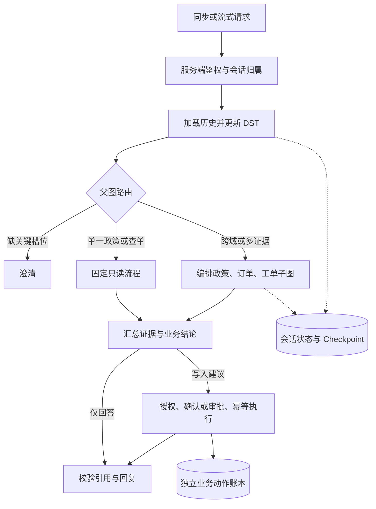
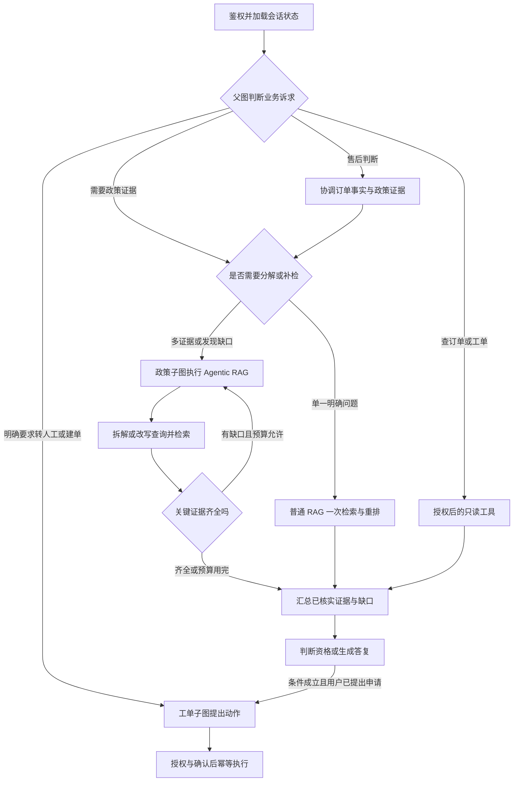
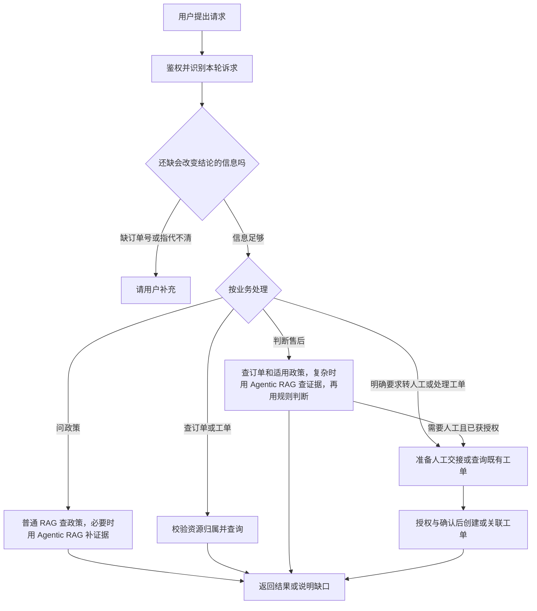
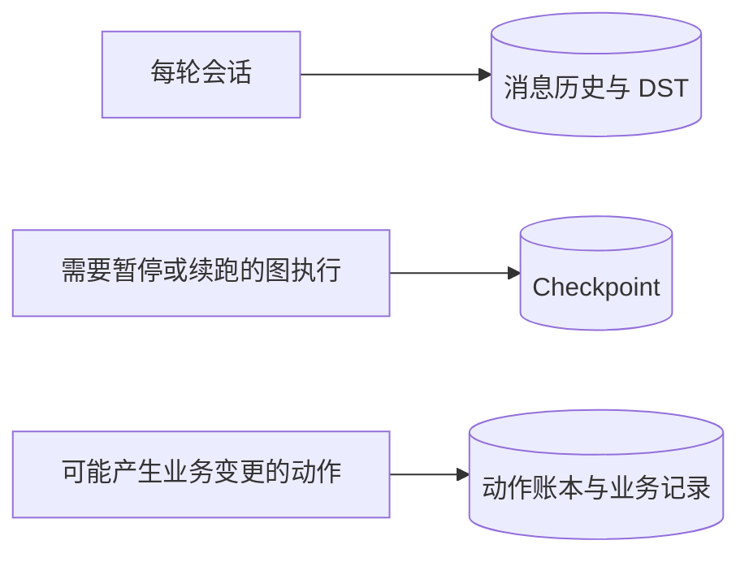

# CustomServiceAgent 整体改造设计

## 1. 目标与首期范围

首期支持政策咨询、查订单、售后资格判断及受控建单。简单政策问答走普通 RAG，证据需求复杂时由政策子图执行 Agentic RAG。涉及订单、政策或工单协作时，由 LangGraph 父图安排专业子图。先以只读场景证明协作和自适应检索的收益，再开放写入。退款资格、退款工单和资金退款分别建模。资金动作先在模拟渠道验证，真实渠道接入和对账通过后另行灰度。

沿用 FastAPI、LangGraph、Milvus、Elasticsearch 和 MySQL。现有 Agent 图按意图进入业务节点，售后分支可直接建单，须把副作用拆到受控执行层。现有普通 RAG 默认候选深度 20、最终上限 5，流式与非流式的检索入口有差异。统一检索入口后保留旧策略作为对照。当前评测数据为 960 条候选和 20 条政策开发题，正式验收集尚未建立。

## 2. 执行架构

### 原整体架构图

原图按系统组件展示请求如何路由、编排及执行。下方的客服业务图按用户诉求展开各条路径，状态保存图单独说明三种持久化职责。原图通向“会话状态与 Checkpoint”的虚线是旧版示意，具体保存条件以下方状态保存图为准。

| 原图节点 | 新图如何展开 |
|---|---|
| 加载历史并更新 DST → 父图路由 | 先结合历史理解“这单”等指代，再判断是否需要澄清，信息足够时按用户诉求分流。 |
| 固定只读流程 | 问单一政策、查订单或查工单。 |
| 编排政策、订单、工单子图 | 售后判断可能组合订单事实与政策。转人工或条件式建单按需再调用工单能力。多条政策也可以由同一个政策子图检索。 |
| 汇总证据与业务结论 → 校验引用与回复 | 把已核实的事实、规则结果和仍待确认的信息转成用户可读的答复。 |
| 授权、确认或审批、幂等执行 | 新图中创建或关联工单的受控执行步骤，实际写入结果记入业务动作账本。 |
| 会话状态与 Checkpoint | 在状态保存图拆开。历史与 DST 用于跨轮理解，Checkpoint 用于恢复需要暂停或续跑的执行。 |

### 现行技术流程图

### 客服请求如何进入流程

| 用户说法 | 由谁处理 | 返回什么 |
|---|---|---|
| 美国普通商品多久可以退 | 固定政策检索 | 适用条款、时限和例外。 |
| 帮我查这单到哪了 | 订单服务，经资源授权后查询 | 可核验的物流状态。缺订单号或指代不明时先澄清。 |
| 我这单还能退吗 | 订单服务取事实，政策检索找适用条款，售后规则服务给结论；涉及多个依赖时由父图协调 | 符合、不符合或待确认，以及原因。查询资格本身是只读操作。 |
| 帮我转人工 | 父图识别转接诉求，工单子图整理上下文并查找既有工单，执行节点按授权创建或关联 | 工单号和实际受理状态。当前首期以工单作为人工接手入口。 |
| 帮我看工单处理到哪了 | 工单服务经资源授权后查询 | 工单当前状态和可披露的进展。 |
| 符合就帮我申请退款 | 先判断资格，再根据当前可用的执行能力处理申请 | 首期可在确认和授权后提交退款申请工单，并说明其处理状态。 |

“跨域”是指一个请求同时需要订单、政策、工单等不同业务能力。“多证据”是指一个结论需要多条材料共同支持。例如“欧盟退货已质检通过，信用卡多久能到账”需要平台发起退款与信用卡到账两条政策，属于同一政策域的多证据题。查单只需订单工具；明确查一条政策时通常一次检索就够。需要组合能力或证据时才升级编排。

### 哪些东西要保存

会话历史和 DST 覆盖简单与复杂路线，用于下一轮理解指代。Checkpoint 按运行能否中断恢复决定使用范围。普通只读查单可以重新查询；任何进入审批等待、异步执行或需要跨进程续跑的图运行都应保存执行位置和中间结果，单一建单任务也适用。动作账本独立记录实际提交结果，用于解决数据库已提交但流程未记录成功的情况。

| 组件 | 职责 |
|---|---|
| 父图 | 管理路由、任务依赖、全局预算、DST 更新和最终答复。首期使用已知工作流模板，模型填充结构化子目标。 |
| 政策子图 | 改写、混合检索、重排和有界补检，返回适用条款、版本、来源与证据缺口。普通路线复用同一检索服务。 |
| 订单子图 | 授权后查询订单，输出最小业务字段。规则服务结合订单事实与已验证政策判断资格，显式区分符合、不符合、待确认。 |
| 工单子图 | 查询授权范围内的已有工单，提出创建或关联建议。执行节点校验后提交。 |

子任务独立时可并行，有依赖时串行。例如订单归属已确认、地区未知时，先查单再查政策；已有可信地区时可并行。条件式建单只有在用户指定条件确定成立时才进入执行。子任务失败时返回明确缺口，部分成功可用于回答已确认的部分。

父传子 `TaskEnvelope` 包含 run ID、task ID、子目标、必要槽位及出处、上游结果引用、超时与调用预算。子返父 `TaskResult` 包含 task ID、状态、已验证事实、证据引用、缺口及候选动作。授权由运行时独立注入。父图按 task ID 与输入版本去重，丢弃旧版本任务结果。并行任务使用独立数据库会话，父图负责合并结果。

## 3. 普通 RAG、Agentic RAG 与自适应重排

| 路线 | 如何执行 |
|---|---|
| **普通 RAG** | 明确的政策问题走一次检索、融合、重排和证据选择。可以按分数断层动态选取证据。 |
| **Agentic RAG** | 复杂问题或首轮有明确证据缺口时，政策子图维护子问题和缺口，决定拆解、改写、扩窗或定向补检，并在证据齐全或预算用完时停止。 |
| **多 Agent 编排** | 父图安排政策、订单和工单能力之间的依赖。例如先查订单地区，再由政策子图选择检索路线。多条政策证据也可由一个政策子图完成。 |

例如，用户问欧盟退货质检后信用卡多久能到账。政策子图分别核对平台发起退款的时间与信用卡到账时间。首轮若只找到信用卡条款，就只针对平台发起时间补检。最终回答说明两段时间的起算点，仍缺证据时明确指出缺口。

1. DST 解析明确的追问和指代。原问保留用于答复与追踪，独立问句可直查，需历史的追问生成独立检索查询。遇到订单指代歧义先澄清。复杂任务拆成能分别检索的证据点，保留原问中的条款号等强关键词。
2. Milvus 和 BM25 按可见性、版本及适用范围召回。保留现有分数加权与 RRF 做实验对照。按稳定证据 ID 去重，保留各路原始排名。每路召回深度、融合后送入重排的窗口、最终保留 N、最终 token 预算各自独立。
3. 获取当前窗口全部重排分数。按单查询分数降序计算相邻差，开发集校准分差绝对门槛和相对突出程度。明显断层只确定优先范围。对断层后 0、1、2 条缓冲做消融。无可信断层时按覆盖率选择。低相关或不适用时允许 N=0。不同查询的分数分别解释，按证据用途合并。
4. 从排序结果选择覆盖必需证据点的最小片段集合，保留改变结论的适用条件和例外。同题证据可能排在尾部时扩窗口；缺不同证据点时改写查询定向补检。重排超时则退回融合排名，仍执行适用性与覆盖检查。预算耗尽且证据不足时输出部分结论或澄清。
5. 首轮实验以 10→20→40 作为可扩窗口候选档位，初始每路召回 20 作为对照起点，扩窗时按实际缺口加深召回。普通题最终硬上限先设 6 条／1500 政策 tokens，复杂题先设 10 条／3000 政策 tokens。复杂路径首轮限制最多三个子任务及全请求累计最多 60 个查询–片段评分对，定向补检最多一轮并共享总预算。超时、额度和终止原因写入追踪。上述数字须经基线验证后确定。

需区分召回候选增长和重排候选增长。同一查询扩大窗口时，只有确认评分服务在不同批次的得分可直接比较，才复用旧分数并只评新增项。否则整窗重评，并将成本纳入预算。

## 4. 上下文、DST 与持久化

- 历史按会话隔离，保存原始消息和轮次。节点按任务取近期历史、相关历史、可回溯摘要和已验证事实。政策子图通常只看业务槽位和政策证据，执行器只看结构化动作与服务端授权。
- DST 逐轮产出槽位增量。槽位记录值、来源、验证状态、轮次及依赖。明确修正覆盖旧值，歧义进入待确认，切换订单使旧订单相关的物流和资格结论失效。模型提出增量，父图验证并应用。
- `AgentState` 区分会话状态与运行状态。新轮次清空运行级证据、动作及子任务结果。子图拥有独立命名空间，状态带 schema 版本及输入版本。并发轮次按会话串行，或使用版本冲突拒绝。
- MySQL Checkpointer 用于恢复图和审批暂停位置。会话、运行和恢复入口重新校验归属与权限。恢复时对过期事实、策略版本和审批重新核查。持久化内容脱敏并设置留存期限。业务动作结果以独立账本为准。

## 5. 工具安全、故障与副作用

每个工具注册输入输出契约、允许角色、资源范围、风险级别、超时和重试规则。服务端验证主体、Agent 能力、资源归属和业务前置条件。直接 API、流式、子图及恢复调用共用同一业务授权层。工单和订单标识来自用户或模型时只作为资源定位参数。业务工具进程没有 Shell、任意 SQL、文件写入和任意网络请求工具。文档、历史、工具输出和子图消息按带来源的数据处理。只返回必要字段，响应和日志检查敏感数据。

| 结果 | 处置 |
|---|---|
| 缺参数或资源歧义 | 澄清；只有能由当前已验证事实修正时才自动修正。 |
| 越权、前置条件失败或审批过期 | 终止当前动作，执行层禁止重试。对外返回不泄露资源存在性的结果。 |
| 只读限流或超时 | 在共享预算内有限退避重试，失败后仅报告已验证事实。 |
| 本地写入断连 | 查询原动作 ID。已提交返回既有结果，明确回滚后复用原 ID 重试。 |
| 外部写入结果未知 | 保持待核对和资金预留，通过查询或验证回调确认。符合渠道幂等契约时才用原键重试，超限人工核对。 |

动作链为 **建议 → 授权与确认／审批 → 持久化 → 执行 → 已确认结果**。审批绑定主体、动作类型、资源、参数摘要、有效期和一次性标识。执行时重查权限及资源状态。使用服务端稳定 action ID 与数据库唯一约束，同键异参拒绝。建单在同一数据库事务中提交动作记录和工单变更。跨会话重复业务申请按现有有效案件关联。

退款接入阶段按原始支付单原子核算已退、处理中与未知金额，使用最小货币单位。将预留、动作与待发送事件同事务提交。执行器使用稳定渠道幂等键；经验证的回调和主动查询按业务状态规则处理重复或乱序。外部受理后、本地记录前崩溃，恢复先核对原动作结果。资金是否到账以可验证的渠道状态为准，回复区分资格、建单、处理中与已成功。

## 6. 评测与发布

现有候选素材可作扩充来源，独立验收按单跳、多证据、改写与 DST、证据不足、工具执行、安全、恢复与幂等、Judge 校准效果八类管理。每类及五项检索／回答主指标至少 101 条可评分的正式样本，目标 120。场景族隔离开发、校准与验收。同一用例可共享指标，重复运行、简单换号和同义改写不增独立样本数。证据标注与答案金标随语料快照版本化。参见 [数据规范](../app/data/eval/v1/README.md)。

| 层级 | 主指标与对照 |
|---|---|
| 召回与排序 | Recall@k、Precision@k、nDCG@k、MRR@k、Context Precision、Context Recall、完整证据覆盖率。分别观测召回、重排、入模三阶段。 |
| 回答 | Faithfulness、Answer Relevancy、Answer Correctness，另报澄清／拒答正确率。百制评分为业务正确 40、证据忠实 25、必要事实覆盖 15、引用 10、表达及下一步 10。 |
| Agent 与上下文 | 任务成功率、pass³、路由混淆矩阵、工具参数与必要调用正确率、DST JGA 和旧槽位误用率。用最终业务状态及允许的副作用判定任务成功。 |
| 安全与可靠性 | 合法任务通过率、攻击成功率、实际泄露、重复副作用、恢复成功率、恢复耗时及状态一致性。注入越权、审批撤销、进程退出、重复提交和回调乱序。 |
| 运行成本 | 按场景记录 P95、实际召回与重排数量、入模 token、每成功任务成本和降级比例。 |

固定 Judge 模型和评分模板，隐藏被测版本。忠实度只以实际可见证据核查逐条主张，正确率另以独立金标核对。校准集用来调整量表，单独的评审验收集检查人工一致率及严重错误漏判率。金额、权限、动作次数和最终状态由程序断言。测试报告保留样本数、成对差值、置信区间和失败原因。

对照顺序为旧图基线 → 统一入口下固定 Top-5 → 仅断层 → 断层加覆盖 → 加扩窗与定向补检。RRF、重排窗口、改写及多 Agent 分开做消融。发布线在测完基线后冻结，拟定目标为回答均分 ≥85、证据忠实度 ≥95%、复杂任务成功率较旧图提升至少 5 个百分点、简单路线 P95 增幅 ≤10%。越权、敏感泄露、关键业务状态虚报和重复副作用为独立阻断项，验收样本中必须为零。

## 7. 实施顺序

1. **评测与授权底座。** 扩充独立样本、完成金标和 Judge 校准，跑旧版基线。建立服务端身份和资源权限矩阵，统一各入口的只读工具边界。
2. **DST 与恢复。** 在父图中接入版本化状态、会话并发控制及故障注入。建立动作账本，在数据库环境验证建单的原子提交、重复恢复和审批撤销。
3. **检索与只读协作。** 合并同步和流式证据入口，跑改写、融合、重排和断层实验，再灰度政策与订单子图。按追踪记录定位每层丢失的证据。
4. **写入及支付模拟。** 开启受控建单，验证回滚和查回结果。使用模拟渠道跑退款并发、未知结果与对账测试。真实支付按渠道契约另行验收。

灰度按能力开关管理复杂路由、自适应检索和写入。关闭复杂路由时保留已通过授权的固定路径。每次运行用同一追踪 ID 关联请求、检索阶段、子任务、工具决策、checkpoint 和业务动作。固定保留版本、耗时、拒绝及降级原因，敏感原文按审计策略管理。
