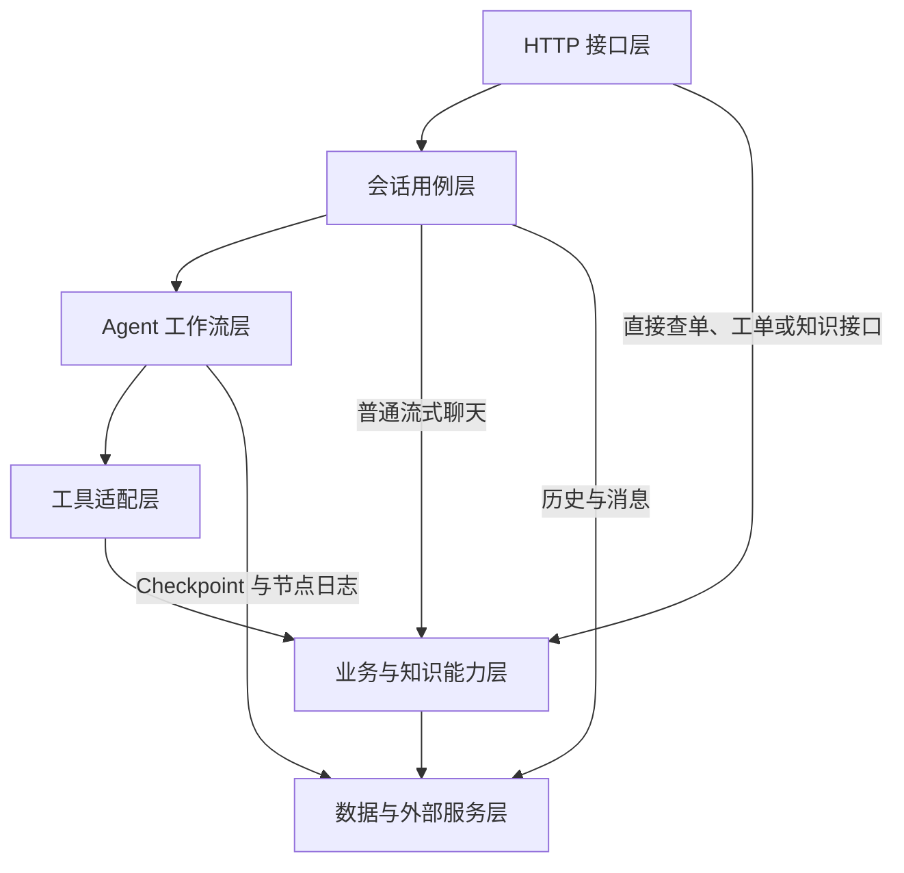

# CustomServiceAgent 项目分层与功能说明

本文描述当前仓库的实现，供第一次阅读项目时使用。分层按代码职责归类，各层运行在同一个 FastAPI 后端进程中。未来方案见 [整体改造设计](agent-platform-design.md)，现有 Agent 的逐节点分析见 [项目架构与 Agent 分层说明](../layers.md)。

## 1. 项目能做什么

| 功能 | 当前实现方案 | 返回结果 |
|---|---|---|
| 政策咨询 | 检索跨境电商政策，重排片段，由聊天模型结合知识生成回答 | 答案和知识来源 |
| 查订单 | 订单号查 MySQL，读取支付、履约、物流及签收字段 | 实际查询到的订单记录或未找到 |
| 判断退款、换货、补发资格 | 读取订单后执行 Python 条件规则 | 资格标志、原因和是否需人工审核 |
| 创建与跟进工单 | MySQL 保存工单和操作日志，提供创建、查看、状态更新和日志接口 | 工单号、状态和操作记录 |
| 转人工诉求 | Agent 的工单分支或售后人工审核分支创建或关联工单 | 供后续处理的记录 |
| 知识维护 | Markdown 入库，或通过 MinerU 解析后索引，提供状态查询和索引重试 | 知识文档、切片和索引状态 |
| 运行排查 | 请求 trace ID、节点日志、RAG 日志、运行日志和后台查询 | 某次请求的处理轨迹 |

项目的业务终点是答复、资格判断和工单记录。真实退款、补发出库、真人接通和客服自动分派尚未接入。

## 2. 一次请求经过哪些层

各层解决不同问题。API 负责接入，会话服务负责本轮消息，Agent 负责选择流程，工具适配器负责把流程参数交给业务服务，业务服务计算或读写结果，基础设施连接数据库、索引和模型。配置、日志及评测横跨这些层。

## 3. HTTP 接口层

| 接口组 | 实现 | 方案 |
|---|---|---|
| 应用入口与健康检查 | [main.py](../app/main.py) | FastAPI 生命周期初始化日志和可选 Checkpointer。应用健康接口返回基本状态，数据库健康检查执行 `SELECT 1`。 |
| 聊天 | [chat.py](../app/api/v1/chat.py) | 创建会话，提供同步 JSON 和 SSE 流式接口。不同入口实际执行路径见下一节。 |
| 订单 | [order.py](../app/api/v1/order.py) | 查询订单详情及 `/orders/{order_no}/aftersales-eligibility`，可直接访问业务服务。 |
| 工单 | [tickets.py](../app/api/v1/tickets.py) | 创建、查询、更新状态、读取操作日志。 |
| 知识 | [knowledge.py](../app/api/v1/knowledge.py) | 文档维护、MinerU 解析任务、向量/BM25/混合搜索、RAG 回答和索引重试。 |
| 管理日志 | [admin.py](../app/api/v1/admin.py) | 分别查询 RAG、Agent 运行和节点日志，支持按 trace ID 查看关联记录。 |

[schemas](../app/schemas) 中的 Pydantic 模型定义请求和响应字段。接口通过依赖注入取得 SQLAlchemy 异步 Session，普通响应由 [ApiResponse](../app/core/response.py) 包装。参数校验与身份授权是不同职责。源码中尚未看到覆盖各业务接口的统一认证及资源归属校验。

## 4. 会话用例层

[ChatService](../app/services/chat_service.py) 负责查找会话、读历史、组织本轮输入、运行图或流式 RAG，并在相应入口保存用户消息及助手答复。会话与消息由 [ChatSession 和 ChatMessage](../app/models/chat.py) 表达。

| 聊天入口（省略默认 `/api/v1`） | 调用路径 | 历史与状态 |
|---|---|---|
| `POST /chat/messages` | 会话服务执行完整 LangGraph | 读取最近 6 条消息，保存本轮消息，以数据库会话主键作为 checkpoint 线程 ID。 |
| `POST /chat/agent/messages` | 路由直接调用图 | 不走会话服务的完整历史加载和消息保存流程，使用请求会话标识作为线程 ID，显式保存运行日志。 |
| `POST /chat/messages/stream` | 会话服务直接调用流式 RAG | 保存本轮消息，绕过 Agent 图。 |
| `POST /chat/agent/messages/stream` | 先在图外分类，RAG 意图走流式 RAG，其他意图调用图 | 读取近期历史并保存消息，非 RAG 图调用未显式传线程配置。 |

阅读会话行为时要先确认入口。例如普通流式聊天主要是知识问答，完整 Agent 图才有售后与建单分支。最近 6 条是消息条数，一问一答通常占两条。

## 5. Agent 工作流与工具适配

### 工作流做的事

| 步骤 | 方案与代码 |
|---|---|
| 构建上下文 | [ContextBuilder](../app/agents/context_builder.py) 从当前问句和近期消息提取订单号、工单引用、上一意图和追问线索，生成可用上下文。 |
| 分类与路由 | [IntentClassifier](../app/agents/intent_classifier.py) 结合规则、近期上下文和模型分类。 [graph.py](../app/agents/graph.py) 用条件边将结果分配到政策问答、查单、售后判断、建单或澄清。 |
| 执行业务节点 | [AgentNodes](../app/agents/nodes.py) 按预设顺序调用 Python 工具。例如售后先查订单，再算资格，必要时建单。 |
| 回复审查 | [ResponseGuard](../app/agents/guardrails.py) 对经过图的答复检查退款保证等风险表达。它位于业务分支之后，工具执行权限需由服务端另行控制。 |
| 运行状态 | [AgentState](../app/agents/state.py) 是图节点共享的类型化字段集合，包括用户问题、意图、订单、来源、动作、答复和审查结果。 |

这是一张预设分支的单 Agent 图。工具选择由节点代码决定。历史提取是轻量会话上下文机制，完整槽位生命周期 DST、Agentic RAG、多 Agent 子图和自主补检属于改造方案。

### 工具适配做的事

[AgentTools](../app/agents/tools.py) 把业务服务封装为图节点可直接调用的 Python 方法。它负责组织参数、序列化结果、追加动作轨迹，并在部分调用中记录失败。

| 工具方法 | 调用能力 | 典型用途 |
|---|---|---|
| `rag_answer` | RagService | 政策查询，将答案与来源交还节点。 |
| `query_order` | OrderService | 查订单并整理可使用字段。 |
| `check_aftersales` | AftersalesRuleService | 对查出的订单计算资格。 |
| `create_or_get_ticket` | TicketService | 按配置查询已有未关闭工单，或创建新工单。 |

当前复用工单采用先查后建的业务逻辑。并发下基于动作 ID 和唯一约束的强幂等属于后续设计。

## 6. 业务与知识能力层

### 订单、售后和工单

- **查单。** [OrderService](../app/services/order_service.py) 通过 SQLAlchemy 按订单号查询 [Order](../app/models/order.py)。返回的是存储的支付和物流状态，读取时不直接请求支付渠道或物流承运商。
- **资格判断。** [AftersalesRuleService](../app/services/aftersales_rule_service.py) 使用确定性 Python 规则。已支付且签收的订单按默认 30 天退款窗口和 45 天换货窗口判断。物流丢失可建议补发并标记人工审核，运输中或缺签收时间等场景也可能需要人工确认。这些通用条件来自代码，政策 RAG 中的地区例外不会自动变成资格规则。
- **工单处理。** [TicketService](../app/services/ticket_service.py) 创建工单号，在数据库写入工单及操作日志，支持按编号查询和状态更新。售后节点在部分需人工审核的分支调用该服务。退款、补发等问题可借工单承接，实际业务完成需后续处理。
- **人工审核。** 节点代码中有使用 LangGraph `interrupt` 的审核节点定义。现有意图路由没有入口边连接该节点。当前可达的人工交接主要通过工单实现。

### 知识入库

[KnowledgeService](../app/services/knoewledge_service.py) 的典型顺序为 **Markdown → 按标题分段 → 长段递归切分与重叠 → MySQL 记录 → 向量化 → Milvus 和 Elasticsearch 建索引 → 更新文档状态**。基础切片配置为 800 字符，重叠 100 字符。MySQL 保存文档与片段、标题路径、内容摘要哈希和索引状态。跨库写入分步骤执行，提供索引错误状态和重试接口。

[文档解析适配器 MinerUService](../app/services/mineru_service.py) 负责提交外部解析任务、查询结果并从归档读取 Markdown。解析任务和索引是两个阶段，知识接口提供独立的索引入口。

### 在线 RAG

[RagService](../app/services/rag_service.py) 的顺序为 **召回 → 可选 Rerank → 拼接知识片段 → 模型生成 → 返回答案与来源**。

| 环节 | 当前采用的方案 |
|---|---|
| 向量召回 | 将查询嵌入为向量，在 Milvus 用 HNSW 索引和余弦相似度召回。 |
| 关键词召回 | Elasticsearch 提供 BM25 搜索接口，也参与混合模式。 |
| 混合排序 | 两路结果按 chunk ID 合并，向量分数截断、BM25 以本轮最高分归一化，再按权重加和。代码默认向量权重 0.7。 |
| 重排 | 默认配置启用。候选深度默认 20，最终条数由请求的 `top_k` 决定，默认 5。重排失败回退到原候选排序。 |
| 生成 | 将最终片段拼入模型提示，返回文本和来源，记录检索及重排信息。 |
| 同步与流式差异 | 非流式按配置选择向量或混合检索，流式直接走向量召回，二者都有重排调用路径。 |

数值是代码默认值，部署环境可以覆盖。当前运行链路的混合算法是加权融合。RRF、按重排分数断层动态选 N、按证据缺口扩窗和补检属于计划。

## 7. 数据、基础设施与观测

| 组件 | 保存或处理什么 | 代码入口 |
|---|---|---|
| MySQL 与迁移 | 聊天、订单、工单及日志、文档与片段、解析任务及运行日志 | [数据库会话](../app/core/database.py)、[ORM 模型](../app/models)、[Alembic 迁移](../migrations) |
| Milvus | 向量索引与片段引用 | [MilvusService](../app/services/milvus_service.py) |
| Elasticsearch | 片段全文与关键词索引 | [ElasticsearchService](../app/services/elasticsearch_service.py) |
| 外部模型接口 | 向量化、重排、意图判断、文本生成和回复审查 | [EmbeddingService](../app/services/embedding_service.py)、[RerankService](../app/services/rerank_service.py)、Agent 与 RAG 各调用方 |
| Checkpointer | 可选 MySQL 保存图运行状态，按线程标识关联 | [checkpoint.py](../app/agents/checkpoint.py) |
| 配置与运行环境 | 服务地址、模型和功能开关，运行说明另存 | [config.py](../app/core/config.py)、[RUNTIME.md](../RUNTIME.md) |
| 追踪与日志 | 请求 trace ID、RAG 结果、部分 Agent 运行与节点耗时、工单操作 | [中间件](../app/core/middleware.py)、[AdminLogService](../app/services/admin_log_service.py) |

聊天表用于查历史消息。Checkpoint 用于保存图状态，入口的线程配置存在差异。RAG 与 Agent 日志用于排查。工单表和工单日志用于业务跟进。节点日志写入可能与业务共用数据库 Session，读源码时不要假定整个对话只在最终做一次原子提交。

## 8. 评测层与阅读示例

| 内容 | 当前状态 |
|---|---|
| 旧检索评测 | [eval_rag.py](../app/scripts/eval_rag.py) 通过候选片段的关键词命中近似判断检索结果。 |
| RAGAS 实验 | [ragas_test.py](../app/data/ragas_test.py) 提供已有实验入口，仓库也保存历史实验产物。 |
| 新候选和开发数据 | [评测规范](../app/data/eval/v1/README.md) 记录 960 条候选、20 条有证据标注的开发题及正式验收缺口。 |
| 新评分脚本 | [检索评分](../app/scripts/score_eval_retrieval.py) 使用证据 ID 算 Precision@k、Recall@k、nDCG@k、MRR@k 和覆盖率。正式留出集及新一轮 Judge 效果分数尚未形成。 |

**从“这单还能退款吗”开始读代码。** 从普通同步聊天接口进入会话服务，加载近期消息，图构建上下文并路由到售后节点。节点查订单并运行资格规则。在需要人工审核的分支，当前代码可能创建或关联工单。回复经过审查后返回。走这条路径可以看到 API、会话、Agent、工具、业务规则及数据库六层如何协作。

**从“信用卡退款多久到账”开始读 RAG。** 图路由到政策问答后，沿 `AgentTools.rag_answer` 进入 `RagService`，再查看检索、融合、重排和提示词构造。对照流式路径，可以定位为什么同一个问题在不同入口可能得到不同的检索结果。

本文基于源码走查，未重新运行数据库、外部模型或检索服务的端到端联调。
