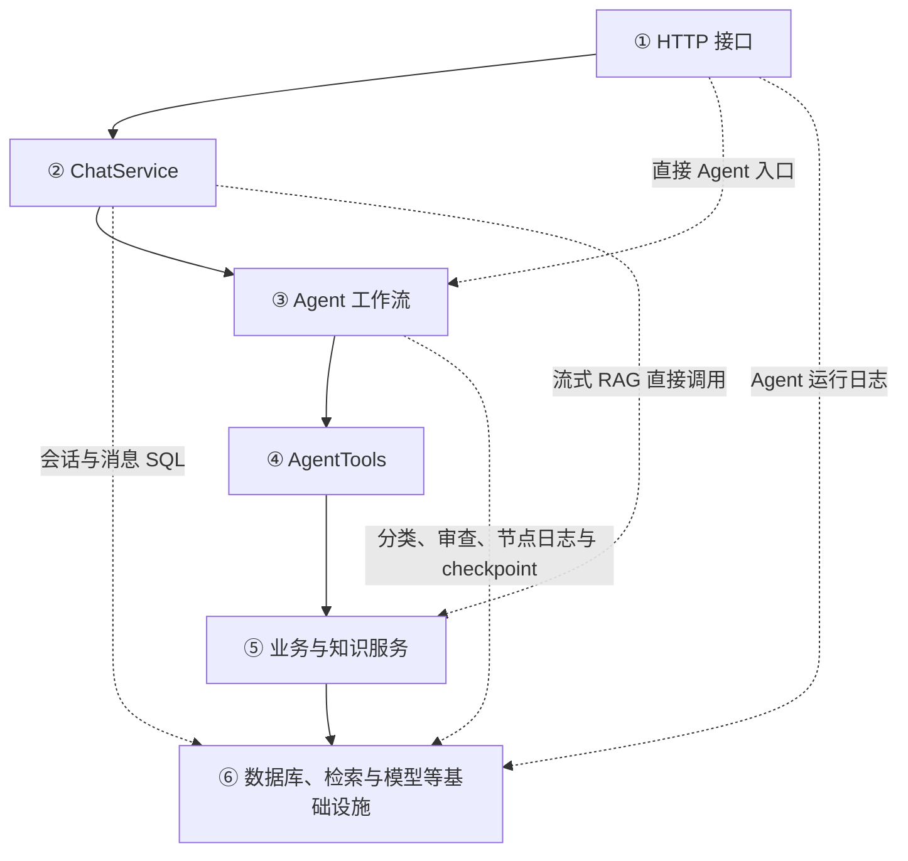
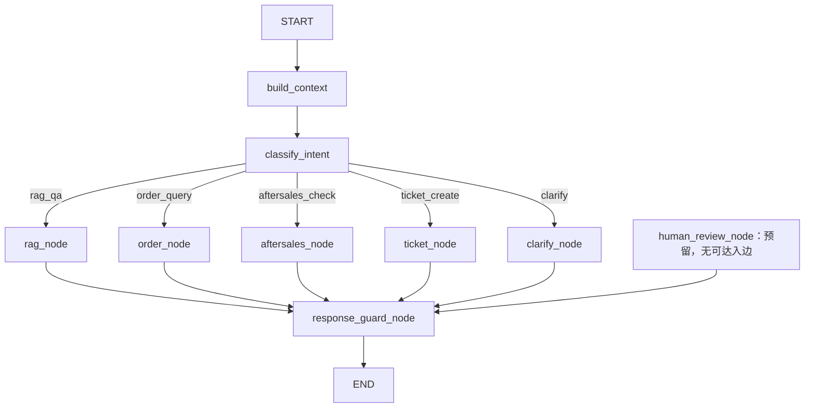

1 file changed
+531
-0
layers.md
# 项目架构与 Agent 分层说明

整理日期：2026-11-03。

本文根据当前源码分析项目的业务边界、职责分层、执行流程、上下文与持久化机制，以及 RAG 评测方式。以 `POST /api/v1/chat/messages` 非流式入口为主要分析路径，其他入口的差异单独说明。

文中明确区分：

- **已实现**：可以在当前代码中找到实际调用和执行路径。
- **预留代码**：已经定义，但尚未形成可达的完整流程。
- **建议设计**：改进方向，不代表当前能力。

验证范围：已核对源码，并对关键上下文、分类、节点、工具及规则函数做过隔离执行。模型响应、订单和工单存储使用模拟对象；没有完成真实 FastAPI、LangGraph checkpoint、数据库和模型服务的端到端验证。文中的评测分数来自仓库已有结果，本次未重新运行评测。

## 1. 项目定位与业务边界

项目是面向跨境电商售后的客服后端，整体采用分层单体结构。核心组合是：

```text
FastAPI 接口 + LangGraph 固定工作流 + RAG + 订单/售后/工单服务
```

业务模块运行在同一个后端应用中，MySQL、Milvus、Elasticsearch、模型 API 和 MinerU 等属于外部依赖。

| 用户诉求 | 处理方式 | 当前业务终点 |
|---|---|---|
| 政策咨询，例如退款期限、到账时间 | 检索知识库并生成回答 | 答案与知识来源 |
| 查询订单、支付、履约和物流状态 | 按订单号查询数据库 | 状态信息或未找到订单的提示 |
| 判断能否退款、换货、补发 | 查询订单并执行 Python 规则 | 资格结论、原因、是否需人工 |
| 转人工、投诉或创建工单 | 创建工单；售后触发时可复用工单 | 待处理工单及工单号 |
| 信息不足 | 提示补充订单号或诉求 | 追问，等待下一轮输入 |

当前自动完成的是咨询、查询、资格计算和建单等操作。代码中没有看到退款打款、生成换货单、实际补发等执行接口。创建工单也不代表已经接通真人、分配客服或完成审批。

### Agent 的实际自主性

它属于工作流式单 Agent，模型主要参与意图分类、RAG 回答和回复审查。

- 意图限定为五类，模型输出分类结果后由图选择固定分支。
- 节点通过 Python 方法直接调用工具，工具选择与执行顺序预先定义。
- 售后节点固定执行查询订单、规则判断和条件建单。
- 工具失败后主要记录错误并抛出异常，没有自主换工具、修复参数或重规划的循环。

因此，将项目描述为“基于 LangGraph 的售后客服工作流与混合检索 RAG 系统”，更符合当前实现。职责分层和日志能力本身不代表自主规划能力。

## 2. 按实际代码划分的六个职责层

以下是职责归类。当前代码没有实现严格隔离的六层依赖边界，上下文构建、分类和审查也不是单独的架构层。

| 职责层 | 接收什么 | 输出什么 | 负责什么 | 关键实现 |
|---|---|---|---|---|
| ① HTTP 接口层 | 请求参数、注入的数据库 Session | `ApiResponse` 或 SSE 事件 | 请求接收、响应映射、异常转换、协议适配 | [chat.py](app/api/v1/chat.py)：`send_message()`、流式路由、`send_agent_message()` |
| ② 会话用例层 | `SendMessageRequest`、数据库 Session | 用户消息、助手消息、Agent 结果；或事件字典 | 校验会话、读取历史、保存消息、准备图输入和执行配置 | [chat_service.py](app/services/chat_service.py)：`ChatService.send_message()`、`get_recent_messages()`、`stream_agent_message()` |
| ③ Agent 工作流层 | `AgentState`、执行配置；节点还持有数据库 Session | 更新后的 `AgentState` | 上下文提取、分类、路由、业务步骤组织、回复审查 | [graph.py](app/agents/graph.py)、[nodes.py](app/agents/nodes.py)、`ContextBuilder`、`IntentClassifier`、`ResponseGuard` |
| ④ 工具适配层 | 状态及问题、订单号、订单对象、工单请求 | 字典、订单对象与序列化结果、工单对象等；同时更新 action 或标记 | 服务调用适配、执行轨迹记录、部分工单复用判断 | [tools.py](app/agents/tools.py)：`AgentTools` |
| ⑤ 业务与知识能力层 | 订单号、订单对象、工单请求、知识问题 | 订单、资格结果、工单、答案与来源 | 订单查询、售后规则、工单操作和 RAG 子流程 | [order_service.py](app/services/order_service.py)、[aftersales_rule_service.py](app/services/aftersales_rule_service.py)、[ticket_service.py](app/services/ticket_service.py)、[rag_service.py](app/services/rag_service.py) |
| ⑥ 基础设施层 | SQL、文本、向量、检索参数、模型及 HTTP 请求 | 数据记录、检索命中、模型响应、解析结果 | 数据库、搜索、向量化、模型访问、文档解析及 checkpoint 存储 | [database.py](app/core/database.py)、[checkpoint.py](app/agents/checkpoint.py)、Milvus/ES/Embedding/Rerank/MinerU 服务及模型客户端 |

第五层内部复杂度不同：`AftersalesRuleService.evaluate()` 是本地规则计算；`RagService.answer()` 则是一条检索、重排、上下文构建和生成的子流程。

### 调用依赖图

实线是主要调用路径，虚线是当前代码已有的其他调用路径；虚线不表示建议或待实现能力。



这张图说明谁调用谁，不是每个请求的时间顺序。跨层调用也不必然是问题，例如会话服务保存消息属于其用例职责；需要关注的是业务决策和流程控制是否分散、重复。

## 3. 调用依赖与运行步骤的区别

调用依赖示例：

```text
AgentNodes → AgentTools → OrderService → SQLAlchemy / MySQL
```

节点调用工具，工具调用服务，服务访问数据库，结果再逐级返回。这不是四个独立的 Agent 流程节点。

真正的运行步骤由 `build_agent_graph()` 的连线定义：



- 每轮通常选择一个业务分支；分支内部可以连续调用多个工具。
- 上下文构建、分类、业务执行和回复审查都是工作流层内部步骤。
- `route_by_intent()` 是只读取 `intent` 的路由函数，不写状态、不调用模型。
- 业务节点修改 `intent` 不会自动重新路由；当前各业务节点的后继仍是回复审查。
- `AgentState` 是数据契约，checkpoint 是存储机制，二者不是业务节点。
- `human_review_node` 虽已注册且有出边，但没有从 START 可达的入边。

## 4. 四个聊天入口的实际差异

以下路径均省略 `/api/v1` 前缀。

| 入口 | 执行方式 | 历史与消息保存 | Checkpoint 配置 | 主要差异 |
|---|---|---|---|---|
| `/chat/messages` | 经 `ChatService` 执行完整 Agent 图 | 读最近 6 条，保存用户与助手消息 | `thread_id=str(session.id)`，使用数据库会话主键 | 有图内审查；未显式写 AgentRunLog |
| `/chat/agent/messages` | 路由直接构图并执行 | 不在此入口加载聊天历史或保存完整聊天消息 | `thread_id=request.session_id`，使用业务会话 ID | 显式写 AgentRunLog，与普通入口不共用相同线程标识规则 |
| `/chat/messages/stream` | 直接调用流式 RAG | 保存用户与助手消息 | 未调用 Agent 图 | 没有图内上下文构建、意图路由和回复审查 |
| `/chat/agent/messages/stream` | 图外先分类；RAG 意图直接流式回答，其他意图调用图 | 读取最近 6 条并保存消息 | 非 RAG 分支调用图时未传相应线程配置 | RAG 分支绕过图内上下文与审查；启用 checkpoint 时需验证非 RAG 路径的配置问题 |

对应实现：`app/api/v1/chat.py` 与 `ChatService.stream_message()`、`stream_agent_message()`。

## 5. 状态、上下文与模型输入

需要区分三个概念：

| 概念 | 实际含义 |
|---|---|
| 任务状态 | `AgentState` 中供代码读写的输入、实体、结果、标记和轨迹 |
| 持久化记录 | 聊天消息、节点日志、checkpoint、RAG 日志和工单等 |
| 模型上下文 | 每次调用模型时，代码显式组织的系统指令、消息和证据 |

字段写入状态或数据库，不会自动进入模型 Prompt，也不代表下一轮能够正确使用。

### 5.1 逐节点状态与 Prompt 对照

下表列出业务逻辑直接读取和修改的字段。写入包含条件赋值，不代表每次清空或覆盖旧值；日志包装器另外会序列化整个输入、输出状态。所有可达节点的状态更新，在启用 checkpoint 时可以被保存，最后一列描述其他常规持久化。

| 节点 | 读取状态 | 写入状态 | 实际传给模型的信息 | 常规持久化 |
|---|---|---|---|---|
| `build_context` | `user_message`、`recent_messages`、已有 `order_no`、`actions` | `recent_order_no`、`recent_ticket_id`、`last_intent`、`is_follow_up`、`memory_used`、`memory_reason`、`context_summary`；按条件补 `order_no`；追加 `actions` | 不调用模型，使用正则和关键词 | 自身没有节点日志，后续日志快照可包含这些结果 |
| `classify_intent` | 先检查 `intent`；需要分类时读取 `user_message`、`recent_messages` | `intent`、`intent_reason`、`intent_classifier`；返回订单号时更新 `order_no` | 固定意图定义、JSON 输出要求、当前消息、从当前消息提取的订单号 | 节点输入输出日志 |
| `rag_node` | `user_message`；工具追加轨迹时读取 `actions` | `answer`、`sources`、`actions` | 回答模型收到固定指令、当前问题、知识片段标题路径/分数/正文；可选重排另接收问题和候选片段 | 节点日志、RAG 日志 |
| `order_node` | `order_no` | 成功后写 `order`、`answer`、`actions`；缺号时写 `intent="clarify"` 和追问 | 节点本身不调用模型，代码拼接回复 | 节点日志；订单表只读 |
| `aftersales_node` | `order_no`、`session_id` | `order`、`aftersales_result`、`answer`、`actions`；需要人工时写 `human_review_required`、`human_review_reason`、`ticket_no` | 节点本身不调用模型，规则判断并拼接回复 | 节点日志；按需写工单及操作日志 |
| `ticket_node` | `user_id`、`order_no`、`session_id`、`user_message` | `ticket_no`、`answer`、`actions` | 节点本身不调用模型 | 节点日志、工单与操作日志 |
| `clarify_node` | 无必要的业务输入字段 | `answer` | 不调用模型，固定追问 | 节点日志 |
| `response_guard_node` | `answer`、`user_message`、`intent` | `guard_checked`、`guard_safe`、`guard_reason`；改写时保存 `original_answer` 并覆盖 `answer` | 有答案时传入固定审查规则、当前问题、意图、待审查答案 | 节点日志 |
| `human_review_node`，预留 | 审核标记、原因、订单号、意图、答案、`actions` | 如果接通：接收 `human_review_result` 并追加审核 action | 不调用模型，使用 `interrupt()` 等待外部结果 | 当前正常请求不会执行 |

补充说明：

- `last_intent` 是根据历史文本关键词重新推测的，不是直接读取上一轮分类结果。
- `context_summary` 是业务字段拼接成的文字，不是对整段历史的语义压缩摘要；目前主要用于状态和 action 记录。
- 分类器的 `context_classify()` 会利用历史处理“用户本轮只补充订单号”的情况；但 `llm_classify()` 没有接收完整历史或已补齐的任务状态。
- 回复审查没有直接接收完整订单、售后结果或知识来源；只能通过答案间接看到部分事实。
- 无答案时审查节点不调用模型，而是记录未检查状态。

### 5.2 路由后的工具结果如何补充上下文

售后分支中的数据流为：

```text
query_order(order_no)
    → 返回 Order 对象和序列化订单
    → 节点写入 state["order"]

check_aftersales(order)
    → 返回资格与原因
    → 节点写入 state["aftersales_result"]
    → 需要人工时，工具还设置审核标记和原因

create_or_get_ticket(request)，按需执行
    → 返回工单对象
    → 节点写入 state["ticket_no"]

各工具调用
    → 向 state["actions"] 追加执行记录
```

当前售后节点会重新查询订单，使用本次返回的 ORM 对象计算规则，而不是直接读取旧 `state["order"]`。

业务代码根据结果决定是否建单，并从原因拼接答案。没有把完整结果追加成 `role="tool"` 的聊天消息，再交给模型自主决定下一步。

RAG 则在服务内部先检索、重排并构建知识上下文，完成生成后才回填 `answer` 和 `sources`。它不会自动把状态中的订单和售后结果合并进 Prompt。

### 5.3 哪些信息持久化，哪些会被下一轮读取

| 存储 | 保存内容 | 下一轮的实际用途 |
|---|---|---|
| `chat_messages` | 用户文本、最终助手文本、会话关联、trace_id 等 | 普通聊天入口读取最近 6 条消息，不是 6 轮对话 |
| `agent_node_logs` | 被包装节点的输入、输出、耗时、状态和异常 | 当前聊天流程不读取它作为记忆 |
| LangGraph checkpoint | 启用时保存图状态，包括可序列化的业务结果与轨迹 | 相同线程可恢复；恢复后字段有效性仍由应用代码管理 |
| `rag_logs` | 问题、RAG 原始答案、来源、检索与重排信息 | 当前不作为聊天记忆读取 |
| `tickets`、`ticket_logs` | 工单内容、状态和操作记录 | 售后建单时可查询并复用未关闭工单 |
| `agent_run_logs` | 整次运行的状态和结果 | 由直接 Agent 入口显式写入；当前不作为聊天记忆读取 |

节点成功时记录输入和输出；失败时记录输入及异常，输出为空。日志与业务操作共用数据库 Session，节点日志的 `commit()` 可能提前提交用户消息或其他待提交记录，因此整次请求不是最终统一提交的单个事务。

RAG 日志保存的是审查前生成结果；如果审查改写了答案，聊天表保存的最终文本可能与 RAG 日志不同。

`ChatSession.summary` 有数据库字段，但未见生成、更新并读取它的流程。`human_review_payload` 仅见状态字段定义。

## 6. 下一轮对话的状态生命周期

`ChatService.send_message()` 每轮显式提供：

```python
{
    "session_id": request.session_id,
    "user_id": session.user_id,
    "user_message": request.content,
    "recent_messages": recent_messages,
    "sources": [],
}
```

图执行使用 `thread_id=str(session.id)`。本轮更新了输入和近期历史，显式清空 `sources`，但没有统一重置意图、订单号、工单号、轨迹和审核标记等字段。

| 情况 | 行为 |
|---|---|
| 不恢复旧图状态 | 从近期聊天文本重新提取订单号等信息；不会从聊天表恢复完整订单、资格结果和工具轨迹 |
| 恢复旧图状态 | 未被本轮覆盖的字段可能保留；当前缺少统一的生命周期与覆盖优先级管理 |
| 结果只保存在日志中 | 当前不会自动被读取为下一轮上下文 |

### 6.1 两轮对话示例

演示订单已支付、签收 10 天且未取消；模型响应使用模拟预设，审查设为安全。

```text
第一轮：帮我查一下 ORDER1001
第二轮：这个订单还能退款吗
```

第一轮结束后可能包含：

```python
{
    "intent": "order_query",
    "order_no": "ORDER1001",
    "order": {...},
    "actions": [...],
}
```

第二轮隔离执行验证的结果如下。恢复状态的情况，是手动将上一轮状态与本轮输入合并后执行原函数，未实测真实 checkpoint：

| 条件 | 实际行为 |
|---|---|
| 仅加载聊天历史，模拟模型返回售后意图 | 上下文补齐订单号，查询最新订单并执行售后规则，得到退款申请资格 |
| 恢复的状态已有 `intent="order_query"` | `_classify_intent()` 直接返回，继续查询订单，没有进入售后判断 |
| 无旧意图，但分类模型调用失败 | 兜底规则只看当前文本，因没有显式订单号而路由到 `rag_qa` |

关键代码为：

```python
if state.get("intent"):
    return state
```

另有两类旧字段残留已通过原函数隔离执行确认：

- 旧状态为 `ORDER1001`，新消息明确查询 `ORDER1002` 时，可能出现 `recent_order_no="ORDER1002"`，但实际查询仍使用 `order_no="ORDER1001"`。上下文节点没有直接采用本轮显式订单号，分类又被旧意图跳过。
- 旧审核标记为真且存在旧工单号时，即使本轮资格结果不需人工，旧 `human_review_required` 和 `ticket_no` 仍可能保留。`actions` 也会继续累积。

`memory_used=true` 只表示规则识别到追问并找到了消息中的订单号，不代表模型使用了完整历史或旧工具结果，也不证明状态中的旧订单号已正确更新。

### 6.2 DST 与 query rewrite 的实现边界

**已实现的简化 DST 行为**：订单等字段提取、追问识别、用户只补充订单号时恢复历史意图、保存工具执行结果。

**尚未形成统一机制**：任务阶段、已确认/待补充槽位、实体覆盖、话题切换、任务完成与重置等状态更新规则。

`AgentState` 是容器，checkpoint 是持久化机制；DST 还需要定义状态如何随本轮输入正确更新。

**当前 RAG 没有 query rewrite**，调用链原样传递当前问题：

```text
state["user_message"]
→ AgentTools.rag_answer(query)
→ RagService.answer(query)
→ 召回、重排、回答
```

例如前一轮问“美国电子产品的退货政策是什么”，本轮问“那超过30天呢”，检索使用的仍是“那超过30天呢”，未根据历史补齐国家、品类和咨询主题。

回复审查中的答案改写与检索前 query rewrite 是两种不同能力。

## 7. 一条请求如何跨层完成

### 7.1 “这个订单还能退款吗”

假定会话存在，历史中有订单 `ORDER1001`；主例不恢复旧意图，模拟分类为 `aftersales_check`，订单已支付、签收 10 天且未取消。

```text
POST /api/v1/chat/messages
→ RequestLoggingMiddleware.dispatch()：建立 trace_id
→ chat.send_message()：接收请求，注入数据库 Session
→ ChatService.send_message()
    → 查询会话
    → get_recent_messages(limit=6)
    → 插入当前用户消息，flush
    → build_agent_graph(db)
    → graph.ainvoke(state, config)
        → build_context_node()：从历史补齐订单号
        → classify_intent()：写入售后意图
        → route_by_intent()：选择售后分支
        → aftersales_node()
            → AgentTools.query_order()
                → OrderService.get_by_order_no() → MySQL
            → AgentTools.check_aftersales()
                → AftersalesRuleService.evaluate()
            → 写入订单与资格结果，拼接答案
        → response_guard_node()
            → ResponseGuard.check() → LLM
        → END
    → 保存助手消息，commit 和 refresh
→ ChatMessageResponse → success_response()
```

上下文虽然补齐了订单号，分类模型收到的订单提示仍是从当前原话提取的 `None`。主例能进入售后分支依赖模拟分类输出；其他实际分支见第 6 节。

资格结果为：

```python
{
    "refundable": True,
    "exchangeable": True,
    "resendable": False,
    "requires_human_review": False,
    "reasons": [
        "订单在签收后30天内，支持退款申请",
        "订单在签收后45天内，支持换货申请",
    ],
}
```

本例不建单、不执行实际退款；访问业务 MySQL、分类模型、审查模型，以及启用时的 checkpoint 存储，不经过 Milvus、ES、Embedding、Rerank 或 MinerU。

普通聊天响应选择性返回答案、消息 ID、意图、订单号、工单号、来源和 actions。完整 `order`、`aftersales_result`、审查标记不是其顶层响应字段，部分资格结论在 action metadata 中。

### 7.2 “包裹丢失，可以补发吗”

输入为“ORDER1001 的包裹丢了，可以补发吗？”，模拟订单已支付、物流为 `lost`、未取消，分类为售后意图。

```text
查询订单
→ 规则返回 resendable=true、requires_human_review=true
→ 查询同订单、同 issue_type=resend 的未关闭工单
→ 无工单则创建，有工单则复用
→ 拼接回复
→ 回复审查
→ END
```

隔离执行确认，创建与复用时工具 action 分别为 `created`、`reused`。新工单优先级由节点固定为 `medium`。

即使设置了 `human_review_required=true`，当前图仍直接进入回复审查，不执行人工审核中断。系统完成的是资格判断和问题记录，实际补发与审批由后续人工或外部系统承接。

## 8. RAG 与知识库链路

### 8.1 知识入库

实现位于 [knoewledge_service.py](app/services/knoewledge_service.py)，文件名按仓库原样保留。

```text
Markdown 或 MinerU 解析结果
→ 按标题层级和递归分隔符切分
→ MySQL 保存文档元数据及切片正文
→ Embedding
→ Milvus 索引
→ Elasticsearch 索引
→ 更新文档状态
```

- 切片配置为 `max_chunk_chars=800`、`chunk_overlap_chars=100`，添加重叠后实际片段可超过基础长度。
- 计算内容 hash，保存标题路径等元数据。
- 管理 pending、indexing、active、failed 等索引状态。
- 索引操作有自动重试，也提供失败文档的手动重试接口。
- MySQL、Milvus 和 ES 之间没有统一事务。ES 批量接口返回的错误列表未被入库调用方检查，可能存在部分索引失败但文档被标为 active 的情况。

### 8.2 非流式回答

```text
当前问题
→ 向量召回 / 混合召回
→ 合并与加权排序
→ 可选 Rerank
→ 构建知识上下文
→ LLM 生成
→ 返回 answer 和 sources，保存 RAG 日志
```

按代码默认值，候选数量为 20，最终取 5 条，混合权重为向量 0.7、BM25 0.3。实际值由运行配置决定，不能将默认值当成本次验证环境的实际配置。

融合按 `chunk_id` 合并；向量分数截断到 0～1，BM25 按本轮最高分归一化，再做线性加权。两路召回目前顺序执行。重排失败时回退到原候选顺序。

`_retrieve_sources()` 当前仅明确区分 hybrid 和其他情况；其他配置值走向量检索。BM25 有独立接口，但不能据此认为任意 RAG 配置都已支持 BM25-only。

流式 `stream_answer()` 直接调用向量检索，没有复用非流式检索选择逻辑，存在行为差异。

## 9. RAG 的验证方式

采用基于固定数据集、调用本地 HTTP 接口的离线评测。当前 [rag_eval_dataset.json](app/data/eval/rag_eval_dataset.json) 有 63 条单轮样本，每条包含 question、reference、expected_doc、expected_keywords。

### 9.1 关键词近似检索评测

脚本：[eval_rag.py](app/scripts/eval_rag.py)。

| 模式 | 接口 | 评分对象 |
|---|---|---|
| vector | `/knowledge/search` | 向量检索结果 |
| bm25 | `/knowledge/bm25-search` | 关键词检索结果 |
| hybrid | `/knowledge/hybrid-search` | 混合检索结果 |
| rag | `/knowledge/rag` | 返回的 sources，不评生成答案 |

判断方法是拼接前 K 条片段正文，匹配 expected_keywords；默认至少出现 2 个关键词即算命中，关键词少于 2 个时要求全部命中。

例如预期为“美国、30个自然日、退款”，仅出现“美国、退款”也算命中。这是近似判断，不保证关键期限或规则正确。虽然数据集有 expected_doc，脚本没有使用它验证正确文档。

指标为 Hit@1、Hit@3、Hit@5 和 MRR@5。项目的 first_hit_rank 是最早满足关键词条件的前 K 条前缀位置，因此 MRR 也基于该近似定义，不是严格按人工标注正确 chunk 计算。

请求失败会计为未命中。脚本写出汇总 CSV 和结果明细 JSON。

### 9.2 Ragas 评测

脚本：[ragas_test.py](app/data/ragas_test.py)。

```text
问题与参考答案
→ 调用 /knowledge/rag
→ 收集 response 和 retrieved_contexts
→ Ragas 模型评审
```

| 指标 | 目的 |
|---|---|
| Faithfulness | 判断答案陈述是否得到检索上下文支持 |
| Response Relevancy | 判断答案是否回应问题 |
| LLM Context Precision With Reference | 评估检索上下文的相关性和排序质量 |
| LLM Context Recall | 评估上下文对参考答案所需信息的覆盖 |

评审模型使用相同 `settings.chat_model` 配置、温度为 0，并提供 Embedding 模型。生成质量判断包含模型评审，分数不能视为人工确认的业务正确率。

实际运行注意事项：

- 文件定义了支持参数、样本保存及 CSV 导出的 `main()`，但实际 `__main__` 未调用它，而是硬编码评测前 20 条。
- 实际入口末尾对评测结果直接调用 `f.write(eval_result)`，没有显式转换为字符串或结构化序列化，写盘逻辑需要核验和修正。
- 始终调用同一个 RAG 接口；比较不同检索策略需要分别设置服务配置，脚本没有自动切换策略。
- 收集阶段跳过 API 失败样本，与检索脚本把失败计为未命中的做法不同。
- 当前评测主要覆盖单轮知识问答，不覆盖多轮、工具执行、业务完成率、流式一致性、延迟和成本，也没有自动回归通过门槛。

### 9.3 仓库已有结果

下表来自已有 JSON 报告，不是本次重新测得；仅凭文件名和汇总值不能确认各次实验的样本数量、配置与条件完全一致。

| 策略 | Faithfulness | Answer Relevancy | Context Precision | Context Recall |
|---|---:|---:|---:|---:|
| Vector | 0.8863 | 0.4823 | 0.8696 | 0.9500 |
| Hybrid | 0.9037 | 0.5451 | 0.8517 | 1.0000 |
| Hybrid + Rerank | 0.7592 | 0.6196 | 1.0000 | 1.0000 |

报告显示某些相关性与上下文指标提高，但重排组的 Faithfulness 降低，不能只凭部分指标判断整体更优。

## 10. 职责混杂与实现缺口

| 位置 | 当前情况 | 实际影响 | 建议边界，当前未实现 |
|---|---|---|---|
| HTTP 路由 | 直接 Agent 入口构图、执行、写运行日志，普通入口则经过会话服务 | 历史、消息保存和线程规则不一致 | 统一请求用例，接口专注协议适配 |
| ChatService | 流式路径另外分类、路由和调用 RAG | 与主图行为分叉，审查和检索策略不一致 | 共享业务编排，以输出适配支持流式 |
| AgentNodes | 组织步骤、组装工单参数、拼接回复、修改状态和提交日志 | 策略、表达、流程与事务耦合 | 节点保留步骤组织与状态映射，其他职责单独封装 |
| AgentTools | 服务适配之外，维护人工标记、工单复用策略，返回 ORM 对象 | 工具承载部分业务策略，调用方理解持久化对象 | 由服务提供业务操作，工具返回统一结构化结果 |
| RagService | RAG 子流程同时创建模型客户端、持有数据库并提交日志 | 模型和存储替换成本较高 | 保留子流程，注入模型和日志依赖 |
| 状态更新 | 入口、上下文、分类、工具分别修改字段 | 旧意图、订单、工单和审核标记残留 | 明确跨轮保留与本轮重算字段及覆盖优先级 |
| 上下文组织 | 信息提取与模型 Prompt 分散 | 已提取信息没有一致进入分类、回答和审查 | 按节点明确选择所需信息并组装输入 |

`OrderService` 目前主要实现数据库查询；`TicketService` 同时创建业务对象并持久化；分类、审查和 RAG 各自创建 `ChatOpenAI`。这些反映了原型阶段的耦合程度，不能按纯领域层和独立模型适配层理解。

其他与真实使用相关的缺口：

- 当前未见用户鉴权及订单归属校验，订单查询仅按订单号执行。
- 售后规则没有使用国家、金额、商品品类等做差异化判断；知识库政策与订单资格判断未统一。
- 主图缺少可达的人工审核与恢复接口。
- 后续已补充 requirements.in、带版本与 hash 的 requirements.txt、Dockerfile、Compose 和 RUNTIME.md，形成最小容器运行环境，并增加 Embedding/Rerank 协议单元测试；业务端到端验证、多轮状态回归和 CI 仍待补齐。
- `main.py` 对 `AppException` 注册了两次异常处理器，通用处理器没有按 `Exception` 注册，需要检查预期的异常行为。

## 11. 已实现、预留与建议设计

| 状态 | 内容 |
|---|---|
| 已实现 | 固定意图路由、近期历史加载、规则字段提取、订单查询、售后规则、条件建单、RAG、回复审查、日志和可配置 checkpoint |
| 已生成但使用有限 | context_summary、last_intent、recent_ticket_id；主要用于状态和记录，没有形成统一模型输入 |
| 预留但未接通 | 人工审核 interrupt 与恢复、ChatSession.summary 的生成使用流程；human_review_payload 仅见字段定义 |
| 建议设计 | 统一入口、状态生命周期管理、DST、按节点组织上下文、query rewrite、工具结果契约、事务和失败恢复、自动回归评测 |

建议的上下文与状态流程如下，不代表当前执行链：

```text
当前消息 + 相关历史 + 上轮状态
→ 解析意图与槽位候选
→ 更新 DST：实体覆盖、任务切换、缺失信息与阶段
→ 路由
    → 业务分支：按需查询最新事实并执行规则
    → RAG 分支：根据相关历史与状态改写检索问题，再召回与生成
→ 更新任务结果与阶段
→ 按节点组织审查/回答所需事实和约束
→ 保存跨轮有用信息，清理本轮临时字段
```

上下文工程不是把全部状态塞给模型，而是让每个节点得到足够、相关、一致且来源明确的信息。状态可记录来源与有效期，Prompt 根据任务筛选并控制 token 预算。

## 12. 项目评价与改进优先级

项目是功能覆盖较广的 RAG 客服原型，具备业务接入与可观测性，适合学习和展示 RAG、LangGraph 与后端服务集成。Agent 自主性有限，业务闭环和可靠性尚未达到成熟生产系统的程度。

确定的售后规则使用固定工作流是合理的。优先应提升现有能力的正确性、一致性与可验证性：

1. **修复行为正确性**：跨轮状态、当前显式实体优先级、流式/非流式一致性、索引错误校验。
2. **补齐真实使用条件**：身份与归属校验、事务和失败恢复、依赖清单、可复现启动方式。
3. **建立验证体系**：覆盖意图切换、订单切换、补充槽位、重复建单、工具失败与审查失败的集成测试；统计任务成功率、错误路由率、失败率、延迟和成本。
4. **按业务需要提升自主性**：选择路径无法预先完全确定的场景，再增加动态工具选择和反馈执行机制，并保持确定业务规则的约束。

推荐阅读顺序：HTTP 聊天入口 → ChatService → graph.py → state.py → nodes.py → tools.py → 对应业务 Service；之后单独阅读知识入库、RAG 和评测脚本。

## 13. 每一层的具体改进建议

本节记录改进建议。后续已补齐最小 Docker 运行环境、可选 Milvus 服务认证，以及工作空间 Embedding/Rerank 适配与离线协议测试，具体状态见 [RUNTIME.md](RUNTIME.md)；其余业务流程、状态生命周期等改进仍未实现。

优先级定义：

- **P0**：优先修复已发现的行为错误、数据归属或一致性问题。
- **P1**：在正确性基础上改善契约、可维护性、效果与验证能力。
- **P2**：有明确业务收益后再扩展的能力。

建议逐项修改、逐项验证；纯规则计算和短链路不必为了分层增加接口与类。

### 13.1 HTTP 接口层：统一协议与身份边界

主要落点：`app/api/v1/chat.py`、`app/api/v1/order.py`、`app/api/v1/tickets.py`、`app/api/v1/admin.py`、`app/schemas/`、`app/main.py`。

| 优先级 | 建议 | 具体改动 | 验收方式 |
|---|---|---|---|
| P0 | 明确调用者身份与数据范围 | 从认证上下文取得 actor；将会话、订单、工单的数据归属交给用例和业务服务校验；管理日志接口单独限制访问范围 | 用户不能读取或操作其他用户的会话、订单、工单；不能通过请求体中的 user_id 更换身份 |
| P0 | 修正异常注册与 HTTP 语义 | 保留 AppException 的业务处理器，将通用异常处理器注册到 Exception；定义资源不存在、参数错误、权限不足、依赖失败等错误码 | 业务异常不会被错误地转换成通用异常；客户端能区分可修正输入、不可访问和服务失败 |
| P1 | 统一响应与 SSE 契约 | 使用明确的回答、来源、业务结果、任务状态和错误结构；接口不直接返回完整 AgentState；SSE 明确进度、内容、最终结果和错误事件 | 同一请求的普通响应和流式最终结果包含一致的业务结论；内部状态和异常细节不会被无差别返回 |
| P1 | 让接口只适配协议 | 普通和直接 Agent 入口都调用统一用例；移出直接构图、运行日志写入和业务分支判断 | 路由代码不再决定使用哪个业务工具，也不独立维护聊天执行流程 |
| P1 | 明确流式审查策略 | 若要求全量审查后才能返回答案，先缓冲答案并审查，再输出；或输出执行进度与最终审查结果，明确延迟取舍 | 不会先发送未经审查的答案，再仅对服务端保存的最终文本进行审查 |

### 13.2 会话用例层：统一一次请求的执行与保存

主要落点：`ChatService.send_message()`、`stream_message()`、`stream_agent_message()`。

| 优先级 | 建议 | 具体改动 | 验收方式 |
|---|---|---|---|
| P0 | 收敛为统一的执行用例 | 由同一用例准备历史、执行图、维护运行记录；普通和流式只选择不同输出适配，不各自分类和路由 | 相同输入、数据和配置下，各入口选择相同业务分支、检索策略与审查机制 |
| P0 | 统一线程和请求标识 | 统一业务 session_id、checkpoint thread_id、turn_id、request_id 的含义；历史 checkpoint 需建立映射或迁移方案 | 更换入口不会切换到另一份会话状态；重复 request_id 能定位同一次处理 |
| P0 | 明确短事务与失败状态 | 用短事务保存接收记录和运行状态，执行外部调用后用短事务保存结果；由明确的用例边界管理业务提交；普通日志不提交业务 Session | 分类或审查失败后，运行状态标记失败或待重试，已提交动作可追踪；不会将未完成请求记为成功 |
| P0 | 管理重试与会话并发 | 同一请求重复提交可幂等返回；同一会话通过串行处理或版本检查避免同时覆盖状态 | 并发请求不覆盖彼此意图和订单；客户端重试不会新增重复用户消息或副作用 |
| P1 | 将历史加载与记忆选择分开 | 用例加载记录；工作流根据任务和 token 预算选择相关历史；仅有需要时才生成并使用长对话摘要 | 较早但仍在处理的任务不会仅因超过最近 6 条就丢失；摘要不会覆盖更新的明确事实 |

事务划分不要求将整次模型和检索调用包在一个长数据库事务中。需要明确哪些状态先保存、哪些业务动作独立提交、失败后如何恢复，以及如何防止重放副作用。

### 13.3 Agent 工作流层：优先修复状态生命周期

主要落点：`state.py`、`graph.py`、`nodes.py`、`context_builder.py`、`intent_classifier.py`、`guardrails.py`。

| 优先级 | 建议 | 具体改动 | 验收方式 |
|---|---|---|---|
| P0 | 区分会话、任务和本轮状态 | 明确每个字段的归属；本轮 intent、answer、sources、actions、审查结果重算；订单与工单按当前任务管理；待审批任务单独保留 | 查订单后问退款能切换意图；切换任务不携带上一个任务的工单和审核标记 |
| P0 | 修正分类跳过条件和实体覆盖 | 移除仅凭已有 intent 就跳过分类的判断；若复用预分类结果，必须确认属于本轮；当前明确订单号优先于旧值，歧义指代则澄清 | ORDER1001 后明确查询 ORDER1002，实际查询一定使用 ORDER1002；历史意图不阻止本轮新识别 |
| P0 | 让规则兜底使用已解析上下文 | 分类规则接收当前输入、解析实体和必要任务状态，而不只看原话；模型输出用结构化 schema 校验 | 模型失败时，“这个订单还能退款吗”仍可结合已确认订单进入正确业务分支或明确追问 |
| P1 | 为不同节点组织上下文 | 分类使用当前问题、相关历史和已确认实体；RAG 使用完整问题和必要事实；审查使用订单事实、规则结论和证据；保留来源与有效期 | 已补齐的订单号能在分类输入中找到；审查能区分真实规则结论与没有依据的承诺 |
| P1 | 明确 DST 更新规则 | 定义槽位的确认、覆盖、清空、待补充信息和任务阶段；规则提取可继续复用，不要求所有更新调用模型 | 支持补充订单号、纠正订单、切换诉求、多订单澄清；过期事实不会未经刷新直接用于新判断 |
| P1 | 接通人工审核闭环 | 增加可达的条件路由；持久化审核任务、关联会话和执行版本；经授权接口恢复；审核结果影响业务状态和后续处理 | 需审核时进入 pending_review；重复或过期审核不会重复执行；拒绝后不会继续输出已批准结论 |
| P2 | 按场景增加自主执行 | 对需要查政策、查历史工单和补证据的任务，再考虑动态工具选择；设置步骤、时间和副作用边界 | 用实际任务成功率证明收益，能解释每次工具调用及停止原因 |

人工审核属于任务状态，不应在每轮开始时一律清除；应将原任务的待审核状态保留在原任务中，避免复制到新的无关任务。

### 13.4 工具适配层：统一输入输出并减少隐式状态修改

主要落点：`AgentTools`、`serialize_order()`、`add_action()`。

| 优先级 | 建议 | 具体改动 | 验收方式 |
|---|---|---|---|
| P0 | 使用明确的工具结果契约 | 用 typed DTO 表达 status、data、error_code、retryable 和业务引用；订单返回序列化快照；避免 ORM、tuple、None 混合作为公共契约 | 未找到、执行失败和成功都有明确结构；上层不依赖 ORM 字段或返回值位置 |
| P0 | 将状态更新集中到节点 | 工具返回资格、审核要求和 action 信息，节点显式更新 AgentState；传入必要参数及 actor、trace、request 等调用上下文 | 调用工具后哪些状态会改变可以在节点中直接看清；工具不会隐藏修改旧工单或审核标记 |
| P0 | 约束有副作用调用的重试 | 为建单等操作传递 operation_id 或幂等键；写入超时先确认执行结果，再决定重试；只对明确的暂时性失败做有界重试 | 超时重试不会新增重复工单；无法确认是否完成的动作有明确状态与后续核验方式 |
| P1 | 下沉工单复用业务策略 | 由 TicketService 提供创建或复用操作，并负责并发约束；工具只适配输入输出与记录结果 | 工单复用规则无需在多个工具或节点重复实现；普通接口和 Agent 使用相同业务规则 |
| P1 | 统一工具可观测性 | 记录工具名称、耗时、状态、错误类型、输入摘要和结果引用；敏感内容按需脱敏，避免重复保存整个对话 | 一个 trace 可以定位失败工具；日志量不会随完整状态在各工具间重复传递而无界膨胀 |

示意结果契约如下，仅表达设计方向，具体数据类型应按工具分别定义：

```python
ToolResult(
    status="success",  # 也可以是 not_found、failed、unknown 等明确状态
    data=OrderSnapshot(...),
    error_code=None,
    retryable=False,
    operation_id="...",
)
```

### 13.5 业务与知识能力层：补业务规则和检索结果的一致性

主要落点：`OrderService`、`AftersalesRuleService`、`TicketService`、`RagService`、`KnowledgeService`、评测脚本。

| 优先级 | 建议 | 具体改动 | 验收方式 |
|---|---|---|---|
| P0 | 在服务层执行数据归属检查 | 订单与工单操作接收可信 actor 并限制数据范围；不能仅依赖 HTTP 层检查 | 从 Agent 或其他入口调用服务，也不能跨用户读取或操作数据 |
| P0 | 使建单与状态转换具有业务约束 | 创建或复用操作配合数据库幂等键及并发控制，避免先查再建竞态；定义允许的工单状态转换 | 相同操作并发提交只产生一个有效结果；非法状态转换被拒绝且不留下错误操作日志 |
| P0 | 统一流式和非流式检索准备 | 抽出共享的召回、融合、重排、证据整理流程；显式处理支持的模式，拒绝无效值；关闭重排时保留原始分数与来源类型 | 相同输入与配置得到一致的检索准备结果；日志不把 Hybrid 结果错误标为纯向量 |
| P1 | 建立有版本的权威售后规则 | 根据业务需要补国家、品类、时间和金额等条件；每次判断返回规则 ID、版本、原因；知识库解释与发布规则对齐 | 同一订单在同一规则版本下得到一致结论；发生政策变更能追溯判断依据 |
| P1 | 在 RAG 分支增加受约束的 query rewrite | 使用相关历史和已确认槽位补全检索问题；分别保留 original_query、retrieval_query 和实体来源；不凭空补充国家、金额或诉求 | “美国电子产品退货政策”之后问“那超过30天呢”能补全检索主题；上下文不明确时追问或保留不确定性 |
| P1 | 让检索与回答保留证据边界 | 用国家、品类、版本等可靠元数据筛选证据；给回答传入来源标识和必要事实；证据不足时返回需确认 | 回答能关联实际证据，旧政策或其他地区政策不会因关键词相似被直接套用 |
| P1 | 完善离线评测 | 使用 expected_doc 对应的可追溯元数据和相关片段标注；分别报告检索、回答与 API 失败率；修正 Ragas 入口和结果序列化；保存数据版本与运行配置 | 能重现各策略对比；失败样本不被静默排除；改动可按基线和阈值决定是否通过 |

RAG 文本用于解释和补充证据，自动执行的资格判断应以明确发布的业务规则为依据。知识库与规则冲突时应暴露冲突或转人工，而不是让生成模型随意覆盖规则结果。

### 13.6 基础设施层：保证资源、错误和存储行为可控

主要落点：`app/core/`、数据库与 ORM、各外部服务适配器、`checkpoint.py`、依赖与部署配置。

| 优先级 | 建议 | 具体改动 | 验收方式 |
|---|---|---|---|
| P0 | 正确处理 ES 部分失败 | 检查 bulk 的 success_count 与 errors；按失败项重试或标记失败，不把返回错误列表视为成功 | 注入部分索引失败后，文档不会直接变成 active；失败项和原因可定位 |
| P0 | 使多存储索引可重试、可核对 | 使用稳定业务 ID 和版本；明确哪些索引已成功，提供幂等写入、补偿或对账；成功发布前确认各索引状态 | 任一步骤失败后重试不制造重复向量；检索不会混入未发布或旧版本内容 |
| P0 | 分离观测日志与业务提交 | 普通节点日志不 commit 业务 Session；需与业务原子保存的审计记录，在业务事务内写入或使用可靠事件机制 | 日志写入不会意外提交业务；关键业务动作与对应审计不会互相矛盾 |
| P1 | 管理外部客户端生命周期 | 在应用生命周期管理连接池与关闭；为 LLM、检索、解析、数据库配置明确的超时与故障策略 | 启停没有客户端资源泄漏；依赖不可用时健康状态和错误结果准确 |
| P1 | 隔离同步阻塞调用 | 对同步 Milvus 等操作使用线程池、工作进程或适当异步适配，不直接阻塞异步请求循环 | 慢检索或写入期间，其他请求仍可被处理；并发延迟通过负载测试验证 |
| P1 | 抽出模型与持久化适配 | 统一模型调用入口、结构化结果校验和错误分类；将 SQL 查询封装为小型存储操作，按需要注入服务 | 替换模型或数据库访问实现时，不必同时修改多个节点的业务逻辑 |
| P1 | 提供可复现运行环境 | 声明与现有语法兼容的 Python 版本并锁定依赖；补配置示例、迁移、启动方式和集成测试环境；重点验证 LangChain/LangGraph/checkpoint 的版本组合 | 新环境按文档可启动并完成一条真实查询与建单链路；评测能记录所用版本 |

### 13.7 推荐落地顺序与跨层验收

不要一次性重写六层。建议按下面的业务结果逐步推进：

| 阶段 | 优先改动 | 跨层验收场景 |
|---|---|---|
| 第一阶段：修正处理对象与意图 | 工作流状态更新、当前实体优先级、服务归属检查、异常映射 | 查 ORDER1001 → 问退款 → 改查 ORDER1002；另一用户无法读取该订单 |
| 第二阶段：统一执行与提交 | 入口收敛、统一 thread_id、请求幂等、工具契约、工单并发控制、日志事务边界 | 普通/流式业务结果一致；重复和并发请求不重复建单；审查失败时能定位已完成动作 |
| 第三阶段：保证检索与规则一致 | 流式检索共享、索引错误处理与版本、规则依据、query rewrite、评测修正 | 多轮政策追问保留主题；索引部分失败不发布；地区和版本条件正确；策略对比可复现 |
| 第四阶段：扩展复杂任务 | 人工审核恢复、长期任务状态、按需动态工具决策 | 审核拒绝/重复审核/断点恢复正确；复杂任务成功率提升且调用成本和步骤可控 |

每个阶段保留已有功能，并以真实可复现的业务用例判断改进是否完成。仅增加层数、抽象接口或 Agent 节点，不作为验收结果。
